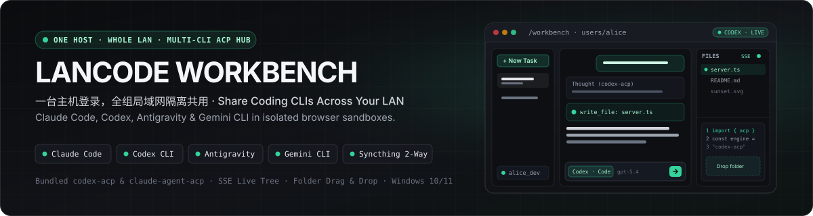
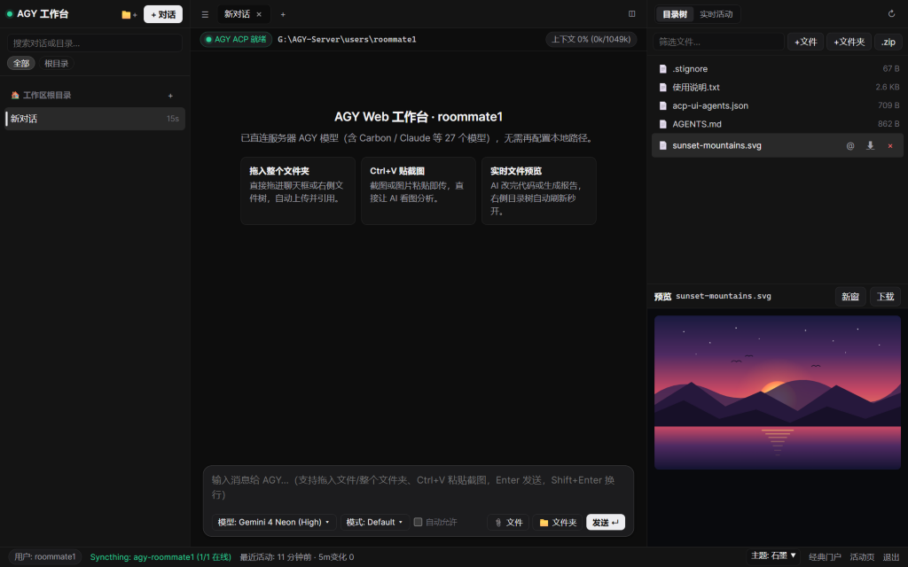
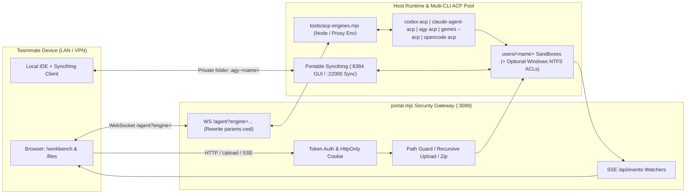

<div align="center">



<p>
  <a href="README.zh-CN.md"></a>
  <a href="https://fangqian616.github.io/LanCode-Workbench/"></a>
  
  
  
  <a href="LICENSE"></a>
</p>

<p>
  <strong>One Host, Whole LAN — Share local Coding CLIs across teammates in isolated browser sandboxes</strong><br />
  一台主机登录，全组局域网隔离共用 · Switch Claude Code / Codex / Antigravity / Gemini CLI live · Folder drag &amp; drop · SSE file tree · Syncthing 2-way sync
</p>

<p>
  <a href="#quick-start-3-minutes">Quick Start</a> ·
  <a href="#supported-cli-engines">Supported CLIs</a> ·
  <a href="#key-features">Features</a> ·
  <a href="#architecture">Architecture</a> ·
  <a href="#operations--cli">CLI Reference</a> ·
  <a href="#security-notes">Security</a> ·
  <a href="https://github.com/fangqian616/antigravity-skip-blackscreen">Related: antigravity-skip-blackscreen</a>
</p>

</div>

---

<p align="center">
  
</p>

---

## Why LanCode Workbench? (Before & After)

Running high-capability coding CLIs across roommates, university labs, or small engineering teams usually means duplicating subscriptions, repeating proxy/Node setups, or handing out risky remote desktop logins. **LanCode Workbench** turns a single authenticated workstation into an isolated multi-user browser workbench over your LAN or VPN.

| Dimension | Shared Desktop / Separate Setups | LanCode Workbench |
| :--- | :--- | :--- |
| **Host & Auth Reuse** | Every teammate repeats proxy tuning, CLI installs, and separate logins | Authenticate **once** on the host; teammates open a link in any browser |
| **Multi-CLI Switching** | Stuck inside one vendor terminal per window | Switch **Codex / Claude Code / Antigravity / Gemini CLI / OpenCode** live in the composer bar |
| **Workspace Isolation** | Shared directories or RDP sessions risk accidental overwrites | Dedicated `users/<name>` sandbox per teammate with enforced server-side `params.cwd` WS injection |
| **File & Folder Transfer** | Manual zip archives, SCP scripts, or chat attachments | Drag & drop files or nested folders directly (`webkitGetAsEntry`), or mount 2-way Syncthing sync |
| **Progress Visibility** | Scrolling raw logs; generated assets stay hidden on remote disk | 3-column UI with persistent sessions, Thought timeline, tool cards, `<60s` SSE highlights & inline preview |
| **Access Security** | Exposes RDP passwords or full local disk credentials | Independent rotatable tokens (`users.json`), HttpOnly cookies & optional Windows NTFS ACLs |

---

## Supported CLI Engines

`LanCode Workbench` speaks standard **Agent Client Protocol (ACP v1)** over JSON-RPC stdio and pre-bundles official ACP adapters so switching CLIs works cleanly on Windows without `.cmd` quoting bugs.

| Engine (`id`) | Adapter / Transport | Host Authentication (Sign In Once) | Bundled in `Install.cmd`? |
| :--- | :--- | :--- | :--- |
| **OpenAI Codex (`codex`)** | `@agentclientprotocol/codex-acp` (via `node.exe`) | `~/.codex` (`codex login`) or `OPENAI_API_KEY` | **Yes** (`^2.8.0` bundled) |
| **Claude Code (`claude`)** | `@agentclientprotocol/claude-agent-acp` (via `node.exe`) | `~/.claude` (`claude login`) or `ANTHROPIC_API_KEY` / `ANTHROPIC_BASE_URL` | **Yes** (`^0.109.0` bundled) |
| **Antigravity (`agy`)** | Native `agy acp` | Local `agy` OAuth session (`AGY_EXE_PATH`) | Host CLI (`tools/agy-launch.mjs`) |
| **Gemini CLI (`gemini`)** | Native `gemini --acp` | `~/.gemini` or `GEMINI_API_KEY` / `GOOGLE_API_KEY` | Auto-detected from PATH / `GEMINI_CLI_PATH` |
| **OpenCode (`opencode`)** | Native `opencode acp` | Local OpenCode provider config | Auto-detected from PATH / `OPENCODE_EXE_PATH` |

---

## Key Features

### 1. Multi-Engine Hot Switching & Sandbox Enforcement
- **Per-Session Engine Selector**: Switch backends directly in the composer toolbar (`Engine: Codex` / `Claude Code` / `Antigravity` / `Gemini CLI` / `OpenCode`), persisting `engineId`, `modelId`, and `modeId` per conversation.
- **Automatic `params.cwd` Locking**: Every WebSocket frame on `/agent?engine=...` has `params.cwd` checked and rewritten server-side inside [`portal.mjs`](portal.mjs) so agents stay strictly confined to `users/<name>`.
- **Proxy Auto-Detection**: [`tools/acp-engines.mjs`](tools/acp-engines.mjs) inherits local proxy detection from [`tools/agy-launch.mjs`](tools/agy-launch.mjs), passing `HTTP_PROXY` / `HTTPS_PROXY` to adapters automatically while keeping loopback traffic direct.

### 2. TAKT-Style 3-Column Web Workbench (`/workbench`)
- **Left Column — Session Sidebar**: Create folders, filter sessions by project subdirectory, and resume persisted histories (`/api/sessions`).
- **Center Column — Real-Time ACP Stream**: Live Thought timeline, tool execution status cards, interactive permission approval prompts, streaming Markdown replies, and Engine / Model / Mode pickers.
- **Right Column — Live File Tree + Inline Preview**: Recursive folder drag-and-drop (`webkitGetAsEntry`), SSE (`/api/events`) real-time updates with `<60s` emerald pulse badges, plus bottom preview for images, SVGs, Markdown, HTML, PDFs, and source code.

### 3. Syncthing Bidirectional Local Sync
- **Portable Integration**: [`install.ps1`](install.ps1) optionally installs portable Syncthing (`127.0.0.1:8384` admin GUI).
- **Private Per-User Folders**: [`syncthing-sync.ps1`](syncthing-sync.ps1) provisions an isolated `agy-<name>` shared folder paired strictly to each teammate's Device ID.

---

## Architecture



---

## Repository Layout

```text
LanCode-Workbench/
├── portal.mjs                  # Multi-user HTTP/SSE/WS gateway, auth & sandbox router
├── tools/
│   ├── acp-engines.mjs         # Multi-CLI engine discovery, ACP spawner & session pool
│   └── agy-launch.mjs          # Antigravity executable discovery & proxy resolver
├── public/
│   ├── workbench.html          # TAKT-style 3-column multi-engine UI shell
│   ├── workbench.css           # Dark graphite / midnight / light / paper themes
│   └── workbench.js            # Engine/Model/Mode pickers, ACP stream & recursive drop
├── docs/                       # Bilingual GitHub Pages showcase & interactive simulator
├── .github/workflows/pages.yml # Automated GitHub Pages deployment
├── httpsbridge.py              # Optional local HTTPS/SOCKS bridge
├── users.example.json          # Bootstrap user config template
├── Install.cmd / install.ps1
├── Start-Server.cmd / start-server.ps1
├── Stop-Server.cmd / stop-server.ps1
├── Manage-Users.cmd / manage-users.ps1
├── Manage-Syncthing.cmd / syncthing-sync.ps1
├── Setup-Isolation-Admin.cmd / setup-isolation.ps1
└── Allow-Firewall.cmd
```

---

## Quick Start (3 Minutes)

### Prerequisites
- **Windows 10 / 11**
- **Node.js `>= 20`** (`node -v`)
- **At least one CLI authenticated on the host** (e.g., `codex login`, `claude login`, `agy`, `gemini`, or API keys such as `OPENAI_API_KEY` / `ANTHROPIC_API_KEY`)
- **Python 3** *(optional — only required for `httpsbridge.py`)*

### 1. Clone & Install
```powershell
git clone https://github.com/fangqian616/LanCode-Workbench.git
cd LanCode-Workbench
.\Install.cmd
```
> `Install.cmd` automatically detects your local proxy and installs `@agentclientprotocol/codex-acp`, `@agentclientprotocol/claude-agent-acp`, `ws`, and optional portable Syncthing (pass `-SkipSyncthing` via `install.ps1 -SkipSyncthing` to skip Syncthing).

### 2. Start the Multi-Engine Workbench
```powershell
.\Start-Server.cmd
# Optional (run once as Administrator for LAN teammates):
.\Allow-Firewall.cmd
```
- **Portal / Workbench**: `http://localhost:3088/` (or `http://<host-ip>:3088/?t=<token>`)
- **Activity Telemetry**: `http://localhost:3088/activity`
- **Syncthing Admin GUI**: `http://127.0.0.1:8384` (loopback-only)

### 3. Add a Teammate & Share Their Link
```powershell
powershell -ExecutionPolicy Bypass -File .\manage-users.ps1 -Action Add -Name alice
powershell -ExecutionPolicy Bypass -File .\manage-users.ps1 -Action Link -Name alice
```

---

## Operations & CLI

All `.ps1` tools have matching double-click `.cmd` entrypoints:

| Area | Common Commands |
| :--- | :--- |
| **Users (`manage-users.ps1`)** | `-Action List` · `-Action Add -Name alice` · `-Action Link -Name alice` · `-Action Rotate -Name alice` · `-Action Remove -Name alice [-DeleteData]` |
| **Syncthing (`syncthing-sync.ps1`)** | `-Action Start \| Stop \| Status \| DeviceId \| SyncFolders` · `-Action Pair -Name alice -DeviceId <ID>` |
| **Windows Isolation (`setup-isolation.ps1`)** | Run `Setup-Isolation-Admin.cmd` or `-Mode Status \| Full \| AclOnly \| Revert [-RemoveUsers]` · `isolation\Login-User.cmd <name>` |
| **Diagnostics (`tools/agy-launch.mjs`)** | `node tools\agy-launch.mjs diagnose` · `npm run check` |

---

## Environment Variables

| Variable | Default | Description |
| :--- | :--- | :--- |
| `LANCODE_DEFAULT_ENGINE` | *(auto-detected)* | Preferred default engine (`codex`, `claude`, `agy`, `gemini`, `opencode`) |
| `OPENAI_API_KEY` / `CODEX_PATH` | `~/.codex` auth | Credentials or custom binary override for `codex-acp` |
| `ANTHROPIC_API_KEY` / `ANTHROPIC_BASE_URL` / `CLAUDE_CODE_EXECUTABLE` | `~/.claude` auth | Credentials, compatible gateway URL, or binary override for `claude-agent-acp` |
| `GEMINI_CLI_PATH` / `OPENCODE_EXE_PATH` / `AGY_EXE_PATH` | *(auto-detected)* | Explicit binary paths for Gemini CLI, OpenCode, or Antigravity |
| `AGY_PROXY_URL` | *(auto-detected)* | Upstream proxy URL, or `off` / `direct` / `none` to bypass |
| `AGY_PORTAL_PORT` | `3088` | HTTP / SSE / WebSocket listening port for `portal.mjs` |
| `AGY_RELAY_PORT` / `AGY_USE_EXTERNAL_RELAY` | `3090` / `0` | Set `AGY_USE_EXTERNAL_RELAY=1` to use legacy external `stdio-to-ws` relay |
| `AGY_CFG_FILE` / `AGY_USERS_DIR` | `./users.json` / `./users` | Custom config file and sandbox root directory paths |
| `AGY_ONLY_USER` / `AGY_DATA_DIR` / `AGY_LOG_DIR` | — | Restrict single user, override session storage or log directories |

---

## GitHub Setup & Recommended Topics

- **Live Showcase (GitHub Pages)**: [`https://fangqian616.github.io/LanCode-Workbench/`](https://fangqian616.github.io/LanCode-Workbench/) (via **Settings -> Pages -> Source: GitHub Actions**).
- **Recommended GitHub Topics**:  
  `claude-code` `codex-cli` `antigravity` `gemini-cli` `agent-client-protocol` `acp` `lan-sharing` `multi-user` `web-workbench` `ai-coding-agent` `syncthing` `self-hosted`

---

## Security Notes

1. **Customize all tokens before exposing to LAN**: Never keep sample placeholders; run `manage-users.ps1 -Action Rotate -Name <user>`.
2. **Keep runtime state untracked**: `.gitignore` excludes `users.json`, `users/`, `syncthing/`, `tools/syncthing/`, logs, and `package-lock.json`.
3. **Restrict network surface**: Expose port `3088` only on a trusted LAN, WireGuard/Tailscale mesh, or authenticated TLS proxy; keep Syncthing GUI bound to `127.0.0.1:8384`.
4. **Optional OS-level isolation**: Use `Setup-Isolation-Admin.cmd` when sharing a machine with untrusted local accounts to enforce Windows NTFS ACLs alongside portal sandbox checks.

---

## Related Projects & Acknowledgements

- **[antigravity-skip-blackscreen](https://github.com/fangqian616/antigravity-skip-blackscreen)**: Companion Windows utility by [@fangqian616](https://github.com/fangqian616) to bypass Antigravity startup black-screen freezes and stabilize local proxy connectivity.
- Workbench ergonomics inspired by **TAKT Workbench**.
- Powered by **Agent Client Protocol (`@agentclientprotocol/codex-acp`, `@agentclientprotocol/claude-agent-acp`)**, **Node.js**, and **Syncthing**.

## License

Released under the [Apache-2.0 License](LICENSE).
