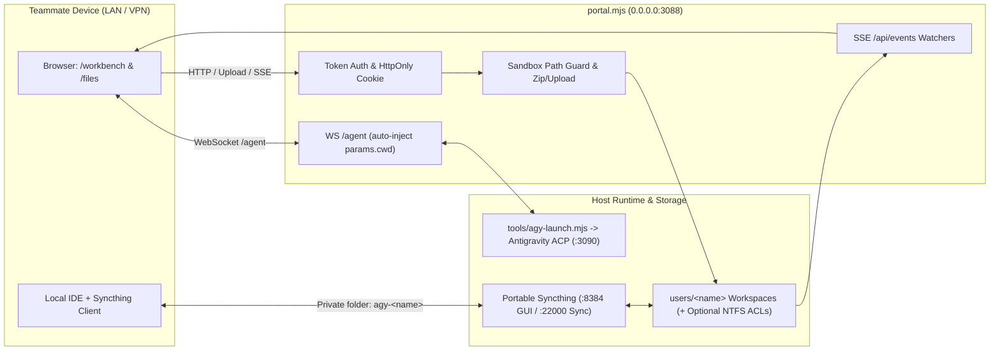

<div align="center">


<p>
  <a href="README.zh-CN.md"></a>
  <a href="https://fangqian616.github.io/AGY-Web-Workbench/"></a>
  = 20" />
  
  
  <a href="LICENSE"></a>
</p>

<p>
  <strong>Turn a single Antigravity host into an isolated multi-user browser workbench</strong><br />
  Per-user sandboxes · TAKT-style 3-column ACP workbench · Recursive folder drag &amp; drop · SSE live file tree · Syncthing 2-way sync
</p>

<p>
  <a href="#quick-start-3-minutes">Quick Start</a> ·
  <a href="#key-features">Key Features</a> ·
  <a href="#architecture">Architecture</a> ·
  <a href="#operations--cli">CLI Reference</a> ·
  <a href="#github-pages-showcase">GitHub Pages</a> ·
  <a href="#security-notes">Security</a> ·
  <a href="https://github.com/fangqian616/antigravity-skip-blackscreen">Related: antigravity-skip-blackscreen</a>
</p>

</div>

---

<p align="center">
  
</p>

---

## Why AGY Web Workbench? (Before & After)

Sharing one Antigravity installation across roommates, lab machines, or small engineering teams quickly hits friction. **AGY Web Workbench** wraps a single host runtime into isolated browser sandboxes served over LAN or VPN without heavy external npm packages.

| Dimension | Shared Desktop / Raw CLI | AGY Web Workbench |
| :--- | :--- | :--- |
| **Workspace Isolation** | Everyone edits the same host directory; accidental overwrites happen easily | Dedicated `users/<name>` sandbox per teammate with enforced server-side `params.cwd` WS injection |
| **File & Folder Transfer** | Manual zip archives, SCP scripts, or out-of-band chat attachments | Drag & drop files or nested folders directly in browser (`webkitGetAsEntry`), or mount 2-way Syncthing sync |
| **Agent Progress Feedback** | Raw terminal scrolling; locating generated SVGs/reports takes manual checks | 3-column UI with persistent sessions, Thought blocks, tool status cards, `<60s` SSE pulse highlights & live preview |
| **Auth & Host Hardening** | Shared Windows desktop login or unauthenticated localhost sockets | Independent per-user login tokens (`users.json`), HttpOnly cookies & optional low-privilege Windows NTFS ACLs |
| **Operational Overhead** | Ad-hoc proxies, watchers, and manual firewall rules | Pure Node.js `>= 20` core (`portal.mjs`) + double-click `.cmd` / `.ps1` management suite |

---

## Key Features

### 1. Multi-User Portal & Sandbox Enforcement
- **Token-Authenticated Access**: Every teammate gets an isolated `/login?token=...` link managed via `Manage-Users.cmd` / `manage-users.ps1`.
- **Automatic `params.cwd` Rewriting**: WebSocket frames sent over `/agent` have `params.cwd` rewritten server-side inside `portal.mjs` so prompts always run inside the logged-in user's workspace.
- **Path Traversal Guard**: File APIs (`/api/tree`, `/api/file`, `/upload`, `/download/*`, `/preview/*`, `/zip/*`) strictly confine normalized paths inside `users/<name>`.
- **Optional Windows OS Isolation**: `Setup-Isolation-Admin.cmd` / `setup-isolation.ps1` provisions local low-privilege Windows users and tightens NTFS ACL boundaries.

### 2. TAKT-Style 3-Column Web Workbench (`/workbench`)
- **Left Column — Session Sidebar**: Create new tasks, switch persistent sessions (`/api/sessions`), view locked user sandbox context.
- **Center Column — Real-Time ACP Stream**: Live Thought timeline, tool execution status badges, streaming Markdown replies, Model & Mode pickers.
- **Right Column — Live File Tree + Inline Preview**: Recursive folder drag-and-drop (`webkitGetAsEntry`), SSE (`/api/events`) real-time incremental updates with `<60s` emerald highlight badges, and built-in bottom preview for images, SVGs, Markdown, and source code.
- **Classic File Browser & Telemetry**: Includes a standalone file view (`/files/*`) and live host dashboard (`/activity`, `/activity.json`).

### 3. Syncthing Bidirectional Local Sync
- **Portable Integration**: `install.ps1` optionally sets up portable Syncthing bound to `127.0.0.1:8384` for admin GUI control.
- **Per-User Private Folders**: `syncthing-sync.ps1` provisions an isolated `agy-<name>` shared folder for each account in `users.json` and pairs exclusively with that user's remote Device ID.
- **Zero Friction Workflow**: Drop/edit code in your local IDE -> changes sync to host sandbox -> Agent edits appear back locally and pulse live in the web UI.

---

## Architecture



---

## Repository Layout

```text
AGY-Web-Workbench/
├── portal.mjs                  # Main multi-user HTTP/SSE/WS portal & sandbox router
├── public/
│   ├── workbench.html          # TAKT-style 3-column workbench shell
│   ├── workbench.css           # Workbench layout, themes & pulse styles
│   └── workbench.js            # ACP stream UI, recursive folder drop & live preview
├── tools/
│   └── agy-launch.mjs          # Antigravity launcher & environment diagnostics
├── httpsbridge.py              # Optional local HTTPS/SOCKS proxy bridge
├── users.example.json          # Bootstrap template automatically copied on first run
├── isolation/
│   └── Login-User.cmd          # Launch shell under isolated local Windows account
├── docs/                       # Static GitHub Pages interactive showcase site
│   ├── index.html              # Bilingual (EN/中文) interactive mini-workbench site
│   ├── style.css               # Precision graphite dark & light themes
│   ├── site.js                 # Interactive ACP/file-tree simulator & i18n controller
│   ├── .nojekyll
│   └── images/
│       ├── banner.svg          # Custom SVG hero banner
│       └── screenshot.png      # Live production workbench screenshot
├── .github/workflows/
│   └── pages.yml               # GitHub Actions workflow for GitHub Pages deployment
├── Install.cmd / install.ps1
├── Start-Server.cmd / start-server.ps1
├── Stop-Server.cmd / stop-server.ps1
├── Manage-Users.cmd / manage-users.ps1
├── Manage-Syncthing.cmd / syncthing-sync.ps1
├── Setup-Isolation-Admin.cmd / setup-isolation.ps1
└── Allow-Firewall.cmd
```

---

## Quick Start (3 Minutes)

### Prerequisites
- **Windows 10 / 11**
- **Node.js `>= 20`** (`node -v`)
- **Antigravity CLI** installed on the host machine
- **Python 3** *(optional — only required if running `httpsbridge.py`)*

### 1. Clone & Bootstrap
```powershell
git clone https://github.com/fangqian616/AGY-Web-Workbench.git
cd AGY-Web-Workbench
.\Install.cmd
```
> Pass `-SkipSyncthing` via `powershell -ExecutionPolicy Bypass -File .\install.ps1 -SkipSyncthing` if you only need browser drag-and-drop uploads without portable Syncthing.

On first boot, if `users.json` does not exist yet, `portal.mjs` automatically initializes it from `users.example.json`.

### 2. Start Services & Open Firewall
```powershell
.\Start-Server.cmd
# Optional (run once as Administrator for LAN/VPN teammates):
.\Allow-Firewall.cmd
```
- **Portal / Workbench**: `http://localhost:3088/workbench` (or `http://<host-ip>:3088/login`)
- **Activity Telemetry**: `http://localhost:3088/activity`
- **Syncthing Admin GUI**: `http://127.0.0.1:8384` (bound to loopback only)

### 3. Add a Teammate & Share Their Link
```powershell
powershell -ExecutionPolicy Bypass -File .\manage-users.ps1 -Action Add -Name alice
powershell -ExecutionPolicy Bypass -File .\manage-users.ps1 -Action Link -Name alice
```
Send the printed URL directly to your teammate—opening it logs them straight into their isolated `/workbench`.

---

## Operations & CLI

All administrative `.ps1` scripts include double-click `.cmd` wrappers in the repository root.

### User Management (`Manage-Users.cmd` / `manage-users.ps1`)
| Action | Command |
| :--- | :--- |
| List users | `.\manage-users.ps1 -Action List` |
| Add user | `.\manage-users.ps1 -Action Add -Name <user> [-Token <custom>]` |
| Print login URL | `.\manage-users.ps1 -Action Link -Name <user>` |
| Rotate token | `.\manage-users.ps1 -Action Rotate -Name <user> [-Token <custom>]` |
| Remove user | `.\manage-users.ps1 -Action Remove -Name <user> [-DeleteData]` |
| Reload config | `.\manage-users.ps1 -Action Refresh` |

### Syncthing Sync (`Manage-Syncthing.cmd` / `syncthing-sync.ps1`)
| Action | Command |
| :--- | :--- |
| Start / Stop / Status | `.\syncthing-sync.ps1 -Action Start \| Stop \| Status` |
| Show Host Device ID | `.\syncthing-sync.ps1 -Action DeviceId` |
| Provision `agy-<user>` folders | `.\syncthing-sync.ps1 -Action SyncFolders` |
| Pair teammate device | `.\syncthing-sync.ps1 -Action Pair -Name <user> -DeviceId <ID> [-DeviceName "Laptop"]` |
| Unpair teammate device | `.\syncthing-sync.ps1 -Action Unpair -Name <user> -DeviceId <ID>` |

### Windows Account & NTFS Isolation (`Setup-Isolation-Admin.cmd` / `setup-isolation.ps1`)
```powershell
# Run via Setup-Isolation-Admin.cmd (UAC) or elevated PowerShell:
.\setup-isolation.ps1 -Mode Status
.\setup-isolation.ps1 -Mode Full       # Create local low-privilege users + NTFS ACLs
.\setup-isolation.ps1 -Mode AclOnly    # Re-apply NTFS ACLs only
.\setup-isolation.ps1 -Mode Revert [-RemoveUsers]

# Switch to an isolated account shell:
isolation\Login-User.cmd <user>
```

### Launcher Diagnostics (`tools/agy-launch.mjs`)
```powershell
node tools\agy-launch.mjs diagnose
node tools\agy-launch.mjs cli --help
```

---

## Environment Variables

| Variable | Default | Description |
| :--- | :--- | :--- |
| `AGY_PORTAL_PORT` | `3088` | HTTP / SSE / WebSocket listening port for `portal.mjs` |
| `AGY_RELAY_PORT` | `3090` | Upstream Antigravity ACP / UI relay port |
| `AGY_CFG_FILE` | `./users.json` | Path to user token and workspace mapping configuration |
| `AGY_ONLY_USER` | *(unset)* | Restrict portal instance to a single named user from config |
| `AGY_DATA_DIR` | *(project root)* | Base directory for user workspaces (`users/<name>`) |
| `AGY_LOG_DIR` | *(runtime logs)* | Output directory for portal and launcher logs |
| `AGY_EXE_PATH` | *(auto-detected)* | Explicit path to the Antigravity executable |
| `AGY_PROXY_URL` | *(env default)* | Upstream proxy URL, or `off` / `direct` / `none` to bypass |
| `BRIDGE_PORT` / `SOCKS_PORT` | — | Port configuration for optional `httpsbridge.py` |

---

## GitHub Pages Showcase

This repository includes a self-contained bilingual interactive landing page & mini-workbench simulator under [`docs/`](docs/index.html) and a ready-to-run workflow at [`.github/workflows/pages.yml`](.github/workflows/pages.yml).

To publish it after pushing to GitHub:
1. Open **Repository -> Settings -> Pages**.
2. Choose **Source: GitHub Actions** *(recommended — automatically triggers `.github/workflows/pages.yml` on changes to `docs/**`)*, **OR** choose **Deploy from a branch -> `main` / `/docs`**.
3. Wait ~1 minute and open `https://fangqian616.github.io/AGY-Web-Workbench/`.

---

## Security Notes

1. **Always customize tokens before opening LAN access**: Never keep placeholder secrets from `users.example.json` in production. Generate fresh tokens with `manage-users.ps1 -Action Rotate -Name <user>`.
2. **Never commit runtime state**: `.gitignore` excludes `users.json`, `users/`, `syncthing/`, `tools/syncthing/`, and runtime logs so credentials never enter Git history.
3. **Bind scope & firewall**: Bind or expose port `3088` only inside a trusted LAN, WireGuard/Tailscale mesh, or authenticated TLS reverse proxy. `Allow-Firewall.cmd` opens TCP `3088`, Syncthing TCP/UDP `22000`, and Syncthing local discovery UDP `21027`; keep Syncthing GUI (`127.0.0.1:8384`) loopback-only.
4. **OS-level multi-tenant hardening**: Server-side path guards isolate browser file APIs, and `setup-isolation.ps1` adds Windows NTFS ACL enforcement when sharing a host with untrusted local sessions.

---

## Related Projects & Acknowledgements

- **[antigravity-skip-blackscreen](https://github.com/fangqian616/antigravity-skip-blackscreen)**: Companion Windows utility by [@fangqian616](https://github.com/fangqian616) to bypass Antigravity startup black-screen freezes and stabilize local proxy connectivity.
- Workbench UX and 3-column ergonomics inspired by **TAKT Workbench**.
- Powered by **Node.js**, **Antigravity ACP**, and **Syncthing**.

## License

Released under the [Apache-2.0 License](LICENSE).
