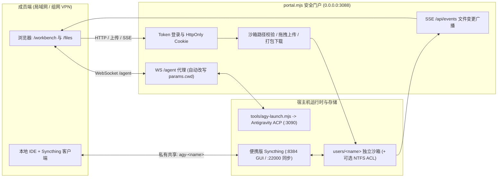

<div align="center">


<p>
  <a href="README.md"></a>
  <a href="https://fangqian616.github.io/AGY-Web-Workbench/"></a>
  = 20" />
  
  
  <a href="LICENSE"></a>
</p>

<p>
  <strong>把一台 Antigravity 主机变成多用户隔离的浏览器 AI 工作台</strong><br />
  独立沙箱目录 · TAKT 风格三栏工作台 · 文件夹递归拖拽上传 · SSE 文件树实时刷新 · Syncthing 双向同步
</p>

<p>
  <a href="#3-分钟快速开始">快速开始</a> ·
  <a href="#核心功能">核心功能</a> ·
  <a href="#系统架构">系统架构</a> ·
  <a href="#运维脚本与命令行手册">命令行手册</a> ·
  <a href="#启用-github-pages-展示站">GitHub Pages</a> ·
  <a href="#安全建议">安全建议</a> ·
  <a href="https://github.com/fangqian616/antigravity-skip-blackscreen">关联工具: antigravity-skip-blackscreen</a>
</p>

</div>

---

<p align="center">
  
</p>

---

## 为什么做 AGY Web Workbench？（改造前后对比）

当室友、实验室成员或小团队共用一台装有 Antigravity 的主机时，直接共用桌面或原始命令行往往会遇到目录混乱、传输繁琐、进度不可见等问题。**AGY Web Workbench** 以纯 Node.js 标准库构建轻量门户与工作台，在零第三方 npm 依赖下实现开箱即用的多用户协作体验：

| 对比维度 | 直接共享原主机 / 命令行 | AGY Web Workbench |
| :--- | :--- | :--- |
| **工作区隔离** | 所有人共用同一目录，极易误删或覆盖他人文件 | 每名成员独占 `users/<name>` 沙箱，服务端强制改写 WebSocket `params.cwd` |
| **文件夹传输与同步** | 手动打 zip、借网盘或临时 SCP 传文件夹 | 浏览器原生递归拖拽整个文件夹上传（`webkitGetAsEntry`），亦支持 Syncthing 双向同步 |
| **实时执行反馈** | 终端刷屏，Agent 生成图片 / 文档后需手动切目录查找 | 三栏工作台展示 Thought 思考链、工具状态卡、60 秒内 SSE 绿点脉冲与底部实时预览 |
| **账号与主机安全** | 远程桌面共享或无鉴权端口暴露全盘权限 | 独立随机 Token 登录链接（`users.json`）+ HttpOnly Cookie，可选低权限 Windows NTFS ACL |
| **部署维护成本** | 手工拼装反代、鉴权、监控和启动脚本 | 纯 Node.js `>= 20` 核心 + 双击即用的 `.cmd` / `.ps1` 全套运维脚手架 |

---

## 核心功能

### 1. 多用户隔离门户与安全边界
- **专属免密直达链接**：管理员通过 `Manage-Users.cmd` / `manage-users.ps1` 生成 `/login?token=...` 登录链接，队友点开即进入自己的工作台。
- **WebSocket `params.cwd` 服务端强制注入**：所有发往 `/agent` 的消息均由 `portal.mjs` 截获并重写为当前账号的独立沙箱路径，防止越权切换目录。
- **路径穿越严格拦截**：`/api/tree`、`/api/file`、`/upload`、`/download/*`、`/preview/*`、`/zip/*` 全部限制在用户目录边界内。
- **可选 Windows 本地低权限账号隔离**：通过 `Setup-Isolation-Admin.cmd` / `setup-isolation.ps1` 自动创建受限 Windows 本地账户并应用 NTFS ACL 权限隔离。

### 2. TAKT 风格三栏 Web 工作台（`/workbench`）
- **左栏 · 会话管理**：支持新建任务、历史会话持久化切换（`/api/sessions`）以及当前隔离身份提示。
- **中栏 · ACP 实时流式交互**：展示模型思考过程（Thought）、工具调用卡片与流式 Markdown 回复，支持模型与工作模式切换。
- **右栏 · 实时 SSE 文件树 + 底部内嵌预览**：支持文件与整文件夹递归拖拽上传，通过 `/api/events` SSE 实时监听工作区变化；60 秒内新改文件带绿色脉冲高亮，点击直接在底部渲染 SVG、图片、Markdown 或源码。
- **经典文件浏览器与主机监控**：提供轻量目录管理视图（`/files/*`）以及 `/activity`、`/activity.json` 实时活动仪表盘。

### 3. Syncthing 本地目录双向同步
- **一键便携部署**：`install.ps1` 自动下载便携版 Syncthing（管理 GUI 仅监听 `127.0.0.1:8384`）。
- **一对一私有共享文件夹**：`syncthing-sync.ps1` 为 `users.json` 中的每位成员创建独立的 `agy-<name>` 共享目录，按设备 ID（Device ID）精确配对。
- **无缝衔接本地 IDE**：成员本地写代码自动同步到服务端沙箱；Agent 在沙箱生成结果后自动同步回成员本机，同时网页端 SSE 立即刷新高亮。

---

## 系统架构



---

## 仓库目录结构

```text
AGY-Web-Workbench/
├── portal.mjs                  # 多用户 HTTP / SSE / WebSocket 安全门户主程序
├── public/
│   ├── workbench.html          # TAKT 风格三栏工作台页面结构
│   ├── workbench.css           # 工作台样式、暗色皮肤与脉冲高亮动画
│   └── workbench.js            # ACP 流式渲染、文件夹递归拖拽与底部文件预览
├── tools/
│   └── agy-launch.mjs          # Antigravity CLI 启动与环境诊断工具
├── httpsbridge.py              # 可选本地 HTTPS/SOCKS 代理桥接脚本
├── users.example.json          # 首次启动自动引导生成的配置模板
├── isolation/
│   └── Login-User.cmd          # 以隔离的本地受限 Windows 账号启动会话
├── docs/                       # GitHub Pages 静态双语交互展示站
│   ├── index.html              # 中英双语切换 + 交互式三栏迷你工作台模拟器
│   ├── style.css               # 石墨暗色 & 清爽亮色双主题样式表
│   ├── site.js                 # 模拟器状态机、CLI 选项卡与多语言字典
│   ├── .nojekyll
│   └── images/
│       ├── banner.svg          # 定制矢量 Hero Banner
│       └── screenshot.png      # 实机运行截图
├── .github/workflows/
│   └── pages.yml               # GitHub Pages 自动构建发布工作流
├── Install.cmd / install.ps1
├── Start-Server.cmd / start-server.ps1
├── Stop-Server.cmd / stop-server.ps1
├── Manage-Users.cmd / manage-users.ps1
├── Manage-Syncthing.cmd / syncthing-sync.ps1
├── Setup-Isolation-Admin.cmd / setup-isolation.ps1
└── Allow-Firewall.cmd
```

---

## 3 分钟快速开始

### 环境要求
- **Windows 10 / 11**
- **Node.js `>= 20`**（可通过 `node -v` 验证）
- 宿主机已安装并登录 **Antigravity CLI**
- **Python 3** *(可选，仅在使用 `httpsbridge.py` 代理桥接时需要)*

### 1. 克隆并初始化安装
```powershell
git clone https://github.com/fangqian616/AGY-Web-Workbench.git
cd AGY-Web-Workbench
.\Install.cmd
```
> 若仅使用网页拖拽上传、不需要 Syncthing 同步，可执行 `powershell -ExecutionPolicy Bypass -File .\install.ps1 -SkipSyncthing`。

首次运行时，若根目录尚不存在 `users.json`，`portal.mjs` 会自动从 `users.example.json` 初始化默认模板。

### 2. 启动工作台并按需放行防火墙
```powershell
.\Start-Server.cmd
# 如需局域网 / 室友跨机访问，以管理员身份运行一次：
.\Allow-Firewall.cmd
```
- **Web 工作台入口**：`http://localhost:3088/workbench`（局域网访问 `http://<主机IP>:3088/login`）
- **实时活动监控**：`http://localhost:3088/activity`
- **Syncthing 本地管理**：`http://127.0.0.1:8384`（默认仅限本机环回访问）

### 3. 添加成员并分发登录链接
```powershell
powershell -ExecutionPolicy Bypass -File .\manage-users.ps1 -Action Add -Name alice
powershell -ExecutionPolicy Bypass -File .\manage-users.ps1 -Action Link -Name alice
```
将终端打印出的专属链接发给对应成员，对方在浏览器打开即可直接登录并使用自己的隔离工作台。

---

## 运维脚本与命令行手册

根目录提供双击即用的 `.cmd` 入口以及完整的 `.ps1` 参数控制：

### 用户管理（`Manage-Users.cmd` / `manage-users.ps1`）
| 功能 | 命令示例 |
| :--- | :--- |
| 列出全部用户 | `.\manage-users.ps1 -Action List` |
| 新增用户沙箱 | `.\manage-users.ps1 -Action Add -Name <用户名> [-Token <自定义Token>]` |
| 获取登录链接 | `.\manage-users.ps1 -Action Link -Name <用户名>` |
| 轮换用户 Token | `.\manage-users.ps1 -Action Rotate -Name <用户名> [-Token <自定义Token>]` |
| 删除用户 | `.\manage-users.ps1 -Action Remove -Name <用户名> [-DeleteData]` |
| 热重载配置 | `.\manage-users.ps1 -Action Refresh` |

### Syncthing 双向同步（`Manage-Syncthing.cmd` / `syncthing-sync.ps1`）
| 功能 | 命令示例 |
| :--- | :--- |
| 启动 / 停止 / 查看状态 | `.\syncthing-sync.ps1 -Action Start \| Stop \| Status` |
| 查看本机 Device ID | `.\syncthing-sync.ps1 -Action DeviceId` |
| 按用户生成私有同步目录 | `.\syncthing-sync.ps1 -Action SyncFolders` |
| 配对成员设备 | `.\syncthing-sync.ps1 -Action Pair -Name <用户名> -DeviceId <设备ID> [-DeviceName "备注"]` |
| 解除设备配对 | `.\syncthing-sync.ps1 -Action Unpair -Name <用户名> -DeviceId <设备ID>` |

### Windows 账户与 NTFS 隔离（`Setup-Isolation-Admin.cmd` / `setup-isolation.ps1`）
```powershell
# 建议右键管理员运行 Setup-Isolation-Admin.cmd，或在管理员 PowerShell 执行：
.\setup-isolation.ps1 -Mode Status
.\setup-isolation.ps1 -Mode Full       # 创建低权限本地 Windows 账户并应用 NTFS ACL
.\setup-isolation.ps1 -Mode AclOnly    # 仅重新校验并应用 NTFS ACL
.\setup-isolation.ps1 -Mode Revert [-RemoveUsers]

# 切换到对应隔离账户会话：
isolation\Login-User.cmd <用户名>
```

### 启动器诊断（`tools/agy-launch.mjs`）
```powershell
node tools\agy-launch.mjs diagnose
node tools\agy-launch.mjs cli --help
```

---

## 环境变量说明

| 变量名 | 默认值 | 用途 |
| :--- | :--- | :--- |
| `AGY_PORTAL_PORT` | `3088` | `portal.mjs` 对外监听的 HTTP / SSE / WebSocket 端口 |
| `AGY_RELAY_PORT` | `3090` | 上游 Antigravity ACP / UI 中继端口 |
| `AGY_CFG_FILE` | `./users.json` | 用户 Token 与沙箱目录映射配置文件路径 |
| `AGY_ONLY_USER` | *(未设置)* | 限制当前门户进程仅允许指定单个用户访问 |
| `AGY_DATA_DIR` | *(项目根目录)* | 用户工作区根路径（`users/<name>`） |
| `AGY_LOG_DIR` | *(运行时日志目录)* | 门户与启动器日志输出目录 |
| `AGY_EXE_PATH` | *(自动探测)* | 手动指定 Antigravity 可执行文件路径 |
| `AGY_PROXY_URL` | *(继承环境)* | 指定上游代理地址，设为 `off` / `direct` / `none` 则直连 |
| `BRIDGE_PORT` / `SOCKS_PORT` | — | 可选 `httpsbridge.py` 代理桥接端口配置 |

---

## 启用 GitHub Pages 展示站

仓库已内置双语交互展示页（[`docs/`](docs/index.html)）及自动部署工作流（[`.github/workflows/pages.yml`](.github/workflows/pages.yml)）：

1. 将仓库推送至 GitHub 后，进入 **Settings -> Pages**。
2. 在 **Build and deployment -> Source** 中选择 **GitHub Actions** *（推荐，修改 `docs/**` 时自动触发发布）*，或选择 **Deploy from a branch -> `main` / `/docs`**。
3. 等待约 1 分钟部署完成，即可访问 `https://fangqian616.github.io/AGY-Web-Workbench/`。

---

## 安全建议

1. **上线前务必替换示例密钥**：切勿在局域网环境直接保留 `users.example.json` 中的示例占位 Token，建议立即运行 `manage-users.ps1 -Action Rotate -Name <用户名>` 生成高强度随机密钥。
2. **保护运行态敏感目录**：`.gitignore` 已屏蔽 `users.json`、`users/`、`syncthing/`、`tools/syncthing/` 与日志文件，提交代码前请勿强制取消忽略。
3. **收敛网络暴露范围**：建议仅在可信局域网、WireGuard / Tailscale 组网或带 HTTPS 鉴权的反向代理内暴露 `3088` 端口。`Allow-Firewall.cmd` 会放行 TCP `3088`、Syncthing TCP/UDP `22000` 及本地发现 UDP `21027`；请保持 Syncthing Web UI（`127.0.0.1:8384`）仅绑定本机环回地址。
4. **多人共享主机建议启用 NTFS 隔离**：Web 门户已拦截文件 API 越权读写，如需防止操作系统层面的跨用户访问，请配合 `Setup-Isolation-Admin.cmd` 开启 Windows 低权限账户与 NTFS ACL 边界。

---

## 关联项目与致谢

- **[antigravity-skip-blackscreen](https://github.com/fangqian616/antigravity-skip-blackscreen)**：作者 [@fangqian616](https://github.com/fangqian616) 维护的配套小工具，用于跳过 Antigravity 启动黑屏故障并稳定本地代理链路。
- 三栏工作台交互与开发流灵感致敬 **TAKT Workbench**。
- 底层驱动：**Node.js** · **Antigravity ACP** · **Syncthing**。
- 本项目基于 [Apache-2.0 License](LICENSE) 开源。
