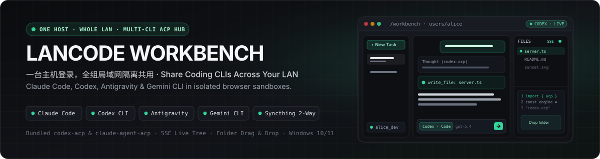
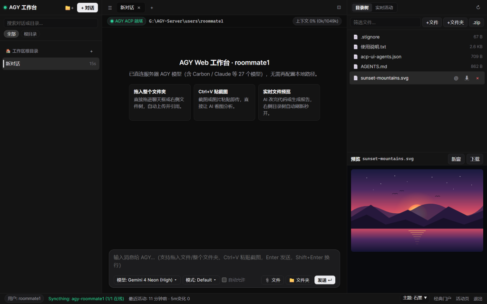
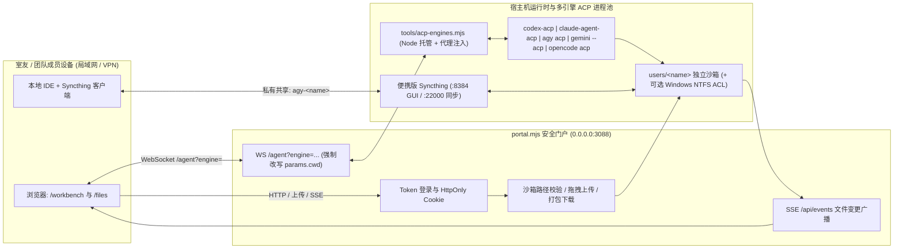

<div align="center">



<p>
  <a href="README.md"></a>
  <a href="https://fangqian616.github.io/LanCode-Workbench/"></a>
  
  
  
  <a href="LICENSE"></a>
</p>

<p>
  <strong>一台主机登录，全组局域网隔离共用</strong><br />
  浏览器切换 Claude Code / Codex / Antigravity / Gemini CLI · 独立用户沙箱 · 文件夹递归拖拽 · SSE 实时预览 · Syncthing 双向同步
</p>

<p>
  <a href="#3-分钟快速开始">快速开始</a> ·
  <a href="#支持的-cli-引擎">支持引擎</a> ·
  <a href="#核心功能">核心功能</a> ·
  <a href="#系统架构">系统架构</a> ·
  <a href="#运维脚本与命令行手册">命令行手册</a> ·
  <a href="#安全建议">安全建议</a> ·
  <a href="https://github.com/fangqian616/antigravity-skip-blackscreen">关联工具: antigravity-skip-blackscreen</a>
</p>

</div>

---

<p align="center">
  
</p>

---

## 为什么做 LanCode Workbench？（改造前后对比）

无论是寝室合租、科研实验室还是小型研发团队，大家往往只需要在一台主力机上折腾好代理和昂贵的 AI Coding CLI 登录态，却没人愿意交出远程桌面密码或混用同一套本地文件夹。**LanCode Workbench** 将一台装好 CLI 的宿主机转化为局域网隔离的多用户浏览器工作台：

| 对比维度 | 各自配置 / 直接共享桌面 | LanCode Workbench |
| :--- | :--- | :--- |
| **主机能力与成本复用** | 每位室友/成员重复折腾代理、Node 环境与多份登录 | **宿主机一次登录**（或配置中转 Key），队友打开浏览器专属链接即用 |
| **多 CLI 引擎热切换** | 单一终端只绑死一个工具，切换模型/CLI 极繁琐 | 网页工具栏一键切换 **Codex / Claude Code / Antigravity / Gemini CLI / OpenCode** |
| **工作区安全隔离** | 共用同一目录或远程桌面，极易误删覆盖他人代码 | 每名成员独占 `users/<name>` 沙箱，服务端强制注入并锁定 `params.cwd` |
| **文件夹上传与同步** | 手动压缩打包 zip、走网盘或 SCP 传项目目录 | 浏览器原生递归拖拽整个文件夹上传，亦可选配 **Syncthing** 本地双向同步 |
| **实时执行可视化** | 终端纯文本刷屏，生成图片 / 网页后还要手动翻目录 | 三栏工作台展示 Thought 思考链、工具状态卡、60 秒绿点脉冲与底部内嵌预览 |
| **账号与主机防线** | 暴露本机桌面锁屏密码与全盘系统文件 | 独立随机可轮换 Token（`users.json`）+ HttpOnly Cookie + 可选 Windows NTFS ACL |

---

## 支持的 CLI 引擎

基于开放标准 **ACP v1（Agent Client Protocol over stdio）**，仓库开箱预装官方 TypeScript ACP 适配器，在 Windows 上直接由 `node.exe` 拉起并自动注入代理，彻底避开 `.cmd` 脚本的跨进程兼容问题：

| 引擎标识 (`id`) | 底层协议 / 适配器 | 宿主机凭据复用方式（配一次全组可用） | 是否随 `Install.cmd` 预装 |
| :--- | :--- | :--- | :--- |
| **OpenAI Codex (`codex`)** | `@agentclientprotocol/codex-acp` | 自动复用 `~/.codex` 登录态（`codex login`）或 `OPENAI_API_KEY` | **是**（内置 `^2.8.0`） |
| **Claude Code (`claude`)** | `@agentclientprotocol/claude-agent-acp` | 自动复用 `~/.claude` 登录态（`claude login`）或 `ANTHROPIC_API_KEY` / 第三方 `ANTHROPIC_BASE_URL` | **是**（内置 `^0.109.0`） |
| **Antigravity (`agy`)** | 原生 `agy acp` | 自动复用宿主机 `agy` OAuth 登录态（`tools/agy-launch.mjs`） | 检测宿主 `agy.exe` |
| **Gemini CLI (`gemini`)** | 原生 `gemini --acp` | 自动复用 `~/.gemini` 或 `GEMINI_API_KEY` / `GOOGLE_API_KEY` | 自动探测 PATH / `GEMINI_CLI_PATH` |
| **OpenCode (`opencode`)** | 原生 `opencode acp` | 自动复用宿主机 OpenCode 配置 | 自动探测 PATH / `OPENCODE_EXE_PATH` |

---

## 核心功能

### 1. 局域网多引擎热切换与沙箱边界
- **会话级引擎自由切换**：可在工作台底部栏一键选择 `Codex / Claude Code / Antigravity / Gemini CLI / OpenCode`，每个会话独立保存 `engineId`、`modelId` 与 `modeId`。
- **WebSocket `params.cwd` 服务端重写**：任何通过 `/agent?engine=...` 发往 CLI 的请求均由 [`portal.mjs`](portal.mjs) 拦截并强制锁定在 `users/<name>` 沙箱内，严防越权访问宿主机目录。
- **代理自动感知透传**：[`tools/acp-engines.mjs`](tools/acp-engines.mjs) 复用 [`tools/agy-launch.mjs`](tools/agy-launch.mjs) 的本地代理探测逻辑，自动将有效代理注入 ACP 子进程环境。

### 2. TAKT 风格三栏 Web 工作台（`/workbench`）
- **左栏 · 项目与会话侧栏**：按工作区子目录分组筛选，随时切换多标签持久化会话（`/api/sessions`）。
- **中栏 · ACP 实时流式交互**：实时呈现 Thought 思考过程、工具调用状态卡、交互式权限确认弹窗、流式 Markdown 回复及引擎 / 模型 / 模式切换器。
- **右栏 · 实时 SSE 文件树 + 内嵌预览**：支持文件与整文件夹递归拖拽上传（`webkitGetAsEntry`），基于 `/api/events` SSE 实现 60 秒内修改文件绿点脉冲高亮，点击直接在底部渲染 SVG、图片、Markdown、HTML、PDF 或源码。

### 3. Syncthing 本地 IDE 双向同步
- **一键便携部署**：[`install.ps1`](install.ps1) 可选自动下载便携版 Syncthing（管理 GUI 仅监听 `127.0.0.1:8384`）。
- **私有同步空间**：[`syncthing-sync.ps1`](syncthing-sync.ps1) 为每位成员分配隔离目录 `agy-<name>`，按 Device ID 配对后，成员本地 IDE 改动与 AI 产物实时同步。

---

## 系统架构



---

## 仓库目录结构

```text
LanCode-Workbench/
├── portal.mjs                  # 多用户 HTTP / SSE / WebSocket 安全门户主程序
├── tools/
│   ├── acp-engines.mjs         # 多 CLI 引擎自动探测、ACP 子进程池与持久化中继
│   └── agy-launch.mjs          # Antigravity 路径发现与本地代理自动检测工具
├── public/
│   ├── workbench.html          # TAKT 风格三栏多引擎工作台界面
│   ├── workbench.css           # 石墨 / 午夜 / 浅色 / 纸张皮肤与脉冲动画
│   └── workbench.js            # 引擎/模型切换、ACP 流渲染、文件夹拖拽与预览
├── docs/                       # GitHub Pages 静态双语交互展示站
├── .github/workflows/pages.yml # GitHub Pages 自动构建发布工作流
├── httpsbridge.py              # 可选本地 HTTPS/SOCKS 代理桥接脚本
├── users.example.json          # 首次启动自动引导的用户配置模板
├── Install.cmd / install.ps1
├── Start-Server.cmd / start-server.ps1
├── Stop-Server.cmd / stop-server.ps1
├── Manage-Users.cmd / manage-users.ps1
├── Manage-Syncthing.cmd / syncthing-sync.ps1
├── Setup-Isolation-Admin.cmd / setup-isolation.ps1
└── Allow-Firewall.cmd
```

---

## 3 分钟快速开始

### 环境要求
- **Windows 10 / 11**
- **Node.js `>= 20`**（可通过 `node -v` 验证）
- **宿主机至少完成任意一种 CLI 登录或 Key 配置**（例如 `codex login`、`claude login`、`agy`、`gemini`，或环境变量 `OPENAI_API_KEY` / `ANTHROPIC_API_KEY`）
- **Python 3** *(可选，仅使用 `httpsbridge.py` 代理桥接时需要)*

### 1. 克隆并一键安装
```powershell
git clone https://github.com/fangqian616/LanCode-Workbench.git
cd LanCode-Workbench
.\Install.cmd
```
> `Install.cmd` 会自动识别本地代理，安装 `@agentclientprotocol/codex-acp`、`@agentclientprotocol/claude-agent-acp`、`ws` 以及可选的便携版 Syncthing（不需要 Syncthing 时可加 `install.ps1 -SkipSyncthing`）。

### 2. 启动工作台并按需放行防火墙
```powershell
.\Start-Server.cmd
# 如需局域网跨设备访问，以管理员身份运行一次：
.\Allow-Firewall.cmd
```
- **工作台入口**：`http://localhost:3088/`（局域网成员打开 `http://<主机IP>:3088/?t=<专属token>`）
- **活动监测视图**：`http://localhost:3088/activity`
- **Syncthing 本地管理**：`http://127.0.0.1:8384`（默认仅限本机访问）

### 3. 添加成员并生成免密链接
```powershell
powershell -ExecutionPolicy Bypass -File .\manage-users.ps1 -Action Add -Name alice
powershell -ExecutionPolicy Bypass -File .\manage-users.ps1 -Action Link -Name alice
```

---

## 运维脚本与命令行手册

| 模块 | 常用命令 |
| :--- | :--- |
| **用户管理（`manage-users.ps1`）** | `-Action List` · `-Action Add -Name alice` · `-Action Link -Name alice` · `-Action Rotate -Name alice` · `-Action Remove -Name alice [-DeleteData]` |
| **双向同步（`syncthing-sync.ps1`）** | `-Action Start \| Stop \| Status \| DeviceId \| SyncFolders` · `-Action Pair -Name alice -DeviceId <ID>` |
| **系统隔离（`setup-isolation.ps1`）** | 运行 `Setup-Isolation-Admin.cmd` 或 `-Mode Status \| Full \| AclOnly \| Revert [-RemoveUsers]` · `isolation\Login-User.cmd <用户名>` |
| **诊断与检查** | `node tools\agy-launch.mjs diagnose` · `npm run check` |

---

## 环境变量说明

| 变量名 | 默认值 | 用途 |
| :--- | :--- | :--- |
| `LANCODE_DEFAULT_ENGINE` | *(自动探测)* | 默认启动引擎（`codex`、`claude`、`agy`、`gemini`、`opencode`） |
| `OPENAI_API_KEY` / `CODEX_PATH` | `~/.codex` 登录态 | 为 `codex-acp` 提供 API Key 或自定义 Codex 二进制路径 |
| `ANTHROPIC_API_KEY` / `ANTHROPIC_BASE_URL` / `CLAUDE_CODE_EXECUTABLE` | `~/.claude` 登录态 | 为 `claude-agent-acp` 提供 Key、第三方兼容网关或 CLI 路径 |
| `GEMINI_CLI_PATH` / `OPENCODE_EXE_PATH` / `AGY_EXE_PATH` | *(自动探测)* | 手动指定 Gemini CLI、OpenCode 或 Antigravity 可执行路径 |
| `AGY_PROXY_URL` | *(自动探测)* | 指定上游代理地址，设为 `off` / `direct` / `none` 则直连 |
| `AGY_PORTAL_PORT` | `3088` | 门户 HTTP / SSE / WebSocket 监听端口 |
| `AGY_RELAY_PORT` / `AGY_USE_EXTERNAL_RELAY` | `3090` / `0` | 设为 `1` 时回退到外置 `stdio-to-ws` 单中继模式 |
| `AGY_CFG_FILE` / `AGY_USERS_DIR` | `./users.json` / `./users` | 自定义用户配置文件与沙箱根目录路径 |
| `AGY_ONLY_USER` / `AGY_DATA_DIR` / `AGY_LOG_DIR` | — | 限制单用户、覆盖会话数据或日志输出目录 |

---

## GitHub 仓库配置与推荐 Topics 标签

- **GitHub Pages 展示站**：[`https://fangqian616.github.io/LanCode-Workbench/`](https://fangqian616.github.io/LanCode-Workbench/)（在 **Settings -> Pages -> Source** 选择 **GitHub Actions**）。
- **推荐填入 GitHub About -> Topics 的标签**：  
  `claude-code` `codex-cli` `antigravity` `gemini-cli` `agent-client-protocol` `acp` `lan-sharing` `multi-user` `web-workbench` `ai-coding-agent` `syncthing` `self-hosted`

---

## 安全建议

1. **上线前务必替换示例密钥**：切勿保留模板占位密钥，建议运行 `manage-users.ps1 -Action Rotate -Name <用户名>` 重新生成随机 Token。
2. **保护运行态敏感目录**：`.gitignore` 已屏蔽 `users.json`、`users/`、`syncthing/`、`tools/syncthing/`、日志与 `package-lock.json`。
3. **收敛网络暴露范围**：仅在可信局域网、WireGuard / Tailscale 组网或带鉴权 HTTPS 反代后暴露 `3088` 端口；保持 Syncthing Web UI 绑定于 `127.0.0.1:8384`。
4. **多人合用主机开启 NTFS 隔离**：配合 `Setup-Isolation-Admin.cmd` 为沙箱施加操作系统级 NTFS ACL 权限边界。

---

## 关联项目与致谢

- **[antigravity-skip-blackscreen](https://github.com/fangqian616/antigravity-skip-blackscreen)**：作者 [@fangqian616](https://github.com/fangqian616) 维护的配套工具，解决 Antigravity 启动黑屏并稳定代理链路。
- 工作台交互灵感致敬 **TAKT Workbench**。
- 底层驱动：**Agent Client Protocol (`@agentclientprotocol/codex-acp`, `@agentclientprotocol/claude-agent-acp`)** · **Node.js** · **Syncthing**。

## 协议

基于 [Apache-2.0 License](LICENSE) 开源。
